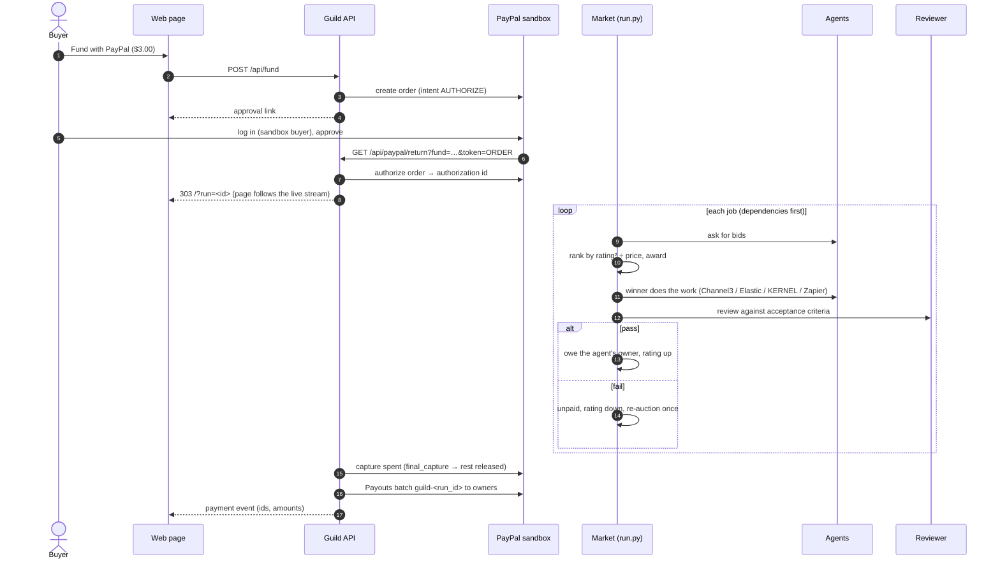

# Architecture

Guild is a small Python service plus a React page. The rules that decide who gets paid are plain, deterministic Python, and the AI and sponsor tools sit at the edges. AI and tools can produce work and verdicts, but **only the market code can move money**, and it moves money only on an exact `pass`.

## One run, step by step

Without PayPal keys, steps 1–7 are skipped and the run ends with a `payment` event in **preview** mode, showing the same amounts with nothing charged.

## Modules

| Module | Responsibility |
|---|---|
| `guild/market.py` | `AgentCard`, `Job`, `Bid` and `Market`. Ranking (eligibility, value, deterministic tie-breaks), reputation, and `settle()`: pay on `pass`, penalise on `fail`, hold otherwise, never past the budget, never twice. |
| `guild/run.py` | Drives one run and reports every step through `emit(event)`. Dependencies, one re-auction after a failure, and a reviewer exception becomes `hold`. |
| `guild/lead.py` | The demo goal and its 5 jobs with acceptance criteria and machine-checkable rules. |
| `guild/brain.py` | `ClaudeLead` (goal to validated job graph), `ClaudeReviewer` (pass/fail/hold) and `GatedReviewer` (rules first, then Claude). Structured outputs; every reply is re-validated. |
| `guild/review.py` | `RuleReviewer`: item counts, required fields and totals. |
| `guild/agents.py` | The five agents. Each real one falls back to labelled sample data when its tool isn't configured or fails. Also `agent_modes()` and owner mapping. |
| `guild/channel3.py`, `kernel.py`, `elastic.py`, `zapier.py` | Thin httpx clients for each sponsor API, written from the official SDKs' endpoints, with an injectable transport for tests. |
| `guild/vendor.py`, `venues.py` | Labelled demo data: the transfer vendor page KERNEL drives, and the venue catalogue indexed into Elastic. |
| `guild/paypal.py` | PayPal REST client: OAuth with refresh, idempotent request ids, and `PayPalError` with `debug_id`. |
| `guild/payments.py` | `build_payout()` and `settle_run()`: capture or void, then one Payouts batch. |
| `guild/funding.py` | Sandbox guard, approval links (`Funds`), `settle()` and `preview()` events, owner mapping. |
| `guild/server.py` | FastAPI: runs in worker threads, the SSE stream, PayPal return/cancel, the vendor page and `/healthz`. Serves `web/dist`. |
| `web/src/market.ts` | Pure reducer from events to tables, story lines and timeline rows. |
| `web/src/studio.tsx` | AG Studio data sources, the starting report, theme and cell renderers. |
| `web/src/Timeline.tsx` | Bryntum Gantt: one row per job, one bar per attempt, coloured by outcome. |

## HTTP API

| Method and path | What it does |
|---|---|
| `POST /api/runs` `{budget}` | Starts an unfunded run and returns `{run_id}`. Budget must be above $0 and at most $10. Rate-limited, with at most 3 runs at once. |
| `GET /api/runs/{id}` | The events so far and `done`. |
| `GET /api/runs/{id}/events` | Server-sent events, one per step, then `end`. |
| `POST /api/fund` `{budget}` | Creates a PayPal AUTHORIZE order and returns `{approve_url}`. Returns 503 if PayPal or a public URL isn't configured. |
| `GET /api/paypal/return?fund&token` | PayPal sends the buyer back here. Authorizes, starts the funded run, and redirects 303 to `/?run=<id>`. |
| `GET /api/paypal/cancel?fund` | Buyer cancelled; redirects with a message. Nothing is charged. |
| `GET /vendor/lisbon-transfers` | Demo vendor page driven by the KERNEL browser. |
| `GET /healthz` | Lead, reviewer, per-agent modes, payments mode, funding available. |
| `GET /api/docs` | OpenAPI UI. |

## Events

| Type | Key fields |
|---|---|
| `plan` | `goal`, `lead`, `reviewer`, `jobs[]` |
| `bids` | `job_id`, `attempt`, `bids[]` (agent, price, eta, stars, value, eligible, reason) |
| `awarded` | `job_id`, `agent_id`, `price` |
| `work` | `job_id`, `agent_id`, `mode` (live or simulated), `tool`, `items`, optional `note` and `live_view_url` |
| `settled` | `job_id`, `agent_id`, `verdict`, `outcome` (paid, unpaid or held), `reasons`, `stars_after`, `spent` |
| `blocked`, `unfunded` | Why a job did not run. |
| `done` | `spent`, `budget`, `owed` |
| `payment` | `mode` (preview, sandbox or error), `authorized`, `captured`, `released`, `payouts[]` (masked), and for sandbox `capture_id` and `payout_batch_id`, or `voided`, or `debug_id` on error |
| `error` | The run failed; no money moved. A funded run's hold is voided. |

## Invariants the tests hold

- Money moves only on an exact `pass`. Hold, error, refusal and unknown verdicts pay nothing.
- `spent` never exceeds the budget, and the sum owed equals `spent` at settlement, or settlement refuses.
- A job is paid at most once. A failed agent is never judged twice on the same job.
- Ranking does not depend on the order bids arrive in.
- Capture and Payouts are idempotent per run. Approval links are single-use and must match the PayPal order.
- PayPal is called only on the sandbox host.
