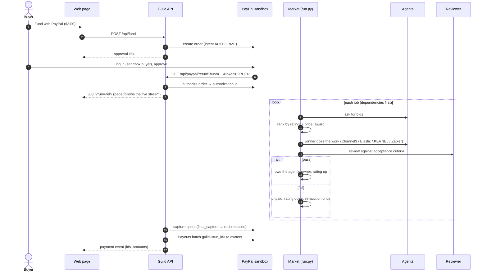

# Architecture

Guild is a small Python service plus a React page. Two products share one verifier:
- **Guild Pay**, a prepaid PayPal wallet the owner loads and an AI agent spends from;
- **deal bounties**, an open market for verified deals.

The rules that decide whether money moves are plain, deterministic Python ([`guild/wallet.py`](../guild/wallet.py), [`guild/bounty.py`](../guild/bounty.py)). Agents and models sit at the edges: an agent can only *ask*, and code decides.

## One wallet purchase, step by step

```mermaid
sequenceDiagram
    autonumber
    actor Owner
    participant Page as Owner page
    participant API as Guild API
    participant PP as PayPal sandbox
    participant Agent as Agent (ShopperBot / REST / MCP)
    participant Shop as Seller site
    participant Index as Independent index (Channel3)

    Owner->>Page: rules + want
    Page->>API: POST /api/wallets → wallet id + owner key (once); the wallet starts empty
    Owner->>Page: Add money
    Page->>API: POST /api/wallets/{id}/top-up {amount}
    API->>PP: Orders v2 CAPTURE, paid to Guild's own sandbox account → approve_url
    Owner->>PP: log in (sandbox buyer), pay
    PP->>API: GET /api/wallets/paypal/topup → capture → wallet credited
    Note over API,Agent: ShopperBot starts once the wallet has money
    Agent->>API: POST /api/wallets/{id}/purchases {url, item, price}
    API->>Shop: fetch page (https, public address only) → schema.org offer
    API->>Index: is this seller listed? typical price for this item?
    API->>Shop: /.well-known/agent-pay.json → seller's PayPal account
    API->>API: decide: blocked (reasons) / pending (over ask-me) / approved
    alt approved (now, or after the owner taps Approve)
        API->>PP: Payouts, one item to the seller, sender_batch_id from the purchase id
        PP-->>API: payout batch id
    end
    Owner->>API: POST /api/wallets/{id}/withdraw (or stop / close)
    API->>PP: refund the top-up captures, newest first, up to what is unspent
    API-->>Page: events: topped_up, purchase, approved, paid, withdrawn, stopped, closed
```

A blocked purchase never reaches PayPal. Without keys, the wallet is in **preview**: a top-up is credited at once as labelled demo money, and payouts and refunds are labelled previews with ids that say PREVIEW.

Promotions (pay-on-proof marketing) use the same money: an approved booking is **held inside the wallet** (reserved; nothing is sent to PayPal). When a proof checks out, the creator is paid with Payouts. A deadline (up to 3 days), a cancel or a stop just releases the reservation.

## One bounty, step by step

```mermaid
sequenceDiagram
    autonumber
    actor Buyer
    participant Page as Web page
    participant API as Guild API
    participant PP as PayPal sandbox
    participant Hunt as Bounty (hunt.py)
    participant Ag as Agents (Guild's + outside)
    participant Shop as Shop page

    Buyer->>Page: want + $2.00 bounty, "Post and fund with PayPal"
    Page->>API: POST /api/fund {kind: hunt, want}
    API->>PP: create order (intent AUTHORIZE)
    API-->>Page: approval link
    Buyer->>PP: log in (sandbox buyer), approve
    PP->>API: GET /api/paypal/return?fund=…&token=ORDER
    API->>PP: authorize order → authorization id
    API-->>Page: 303 /?hunt=<id>  (page follows the live stream)
    Hunt->>Ag: bounty open (house agents start; outside agents see GET /api/bounties)
    loop every claim, as it arrives
        Ag->>Hunt: claim {url, price}
        Hunt->>Shop: fetch (https, public address only)
        Hunt->>Hunt: read schema.org offer, check terms → ✓ or ✗ + reasons, rating
    end
    Hunt->>Hunt: cheapest verified claim before the deadline wins
    Hunt->>Hunt: deal → Elasticsearch history, Zapier alert
    API->>PP: capture the bounty
    API->>PP: Payouts batch guild-<id> to the winner's developer
    API-->>Page: payment event (ids, amounts)
```

With no verified claim, or if the bounty crashes, step 14 onward is replaced by a **void** of the authorization. Without PayPal keys, the payment steps are skipped and the bounty ends with a `payment` event in **preview** mode, showing the same amounts with nothing charged.

## Modules

| Module | Responsibility |
|---|---|
| `guild/wallet.py` | `Policy` (the most the wallet holds, limit per purchase, ask-me amount, want, envelopes) and `Wallet.decide()`: approved, pending or blocked with reasons. Top-ups, `returnable()` and withdrawals; the agent can only spend loaded money. Pending purchases and held promotions reserve money; approve, reject and record_payment only move forward; stop and close. |
| `guild/walletpay.py` | PayPal for wallets: top-up checkout through single-use return links, capture on return; Payouts for approved purchases and for promotions whose proof checked out; return unspent money as refunds of the top-up captures. A labelled preview without keys. |
| `guild/wallet_api.py` | Wallets over HTTP: owner key (hashed, `X-Owner-Key`), agent binding, verification plus seller card plus decision per request, promotions and proofs, events, a 15-minute lifetime (closing returns unspent money). |
| `guild/promo.py` | Pay-on-proof briefs and `check_proof()`: live, on the creator's channel, links to the owner's page, visible ad disclosure, required words. Pure. |
| `guild/shopper.py` | ShopperBot: a capped Claude tool loop (search, read_page, buy, done), or a labelled script. Starts once the wallet has money. |
| `guild/sellers.py` | `/.well-known/agent-pay.json` seller cards: the PayPal account (email or PayPal ID) that Payouts pays. |
| `guild/bounty.py` | Deal bounty rules: `Want`, `Claim`, reading schema.org offers from a page, `verify()`, `pick_winner()`, claim limits. |
| `guild/hunt.py`, `hunters.py` | Runs one bounty: house agents (Scout, Browser, QuickFind) and outside agents' claims, each verified as it arrives. |
| `guild/deals.py` | After a verified deal: store it in the deal history (Elasticsearch `guild-deals`, memory without keys) and send the Zapier "deal found" alert. Neither can change who is paid. |
| `guild/registry.py` | Outside developers' agents: registration, hashed tokens, persisted reputation. |
| `guild/fetcher.py`, `shops.py` | SSRF-safe page fetcher; labelled demo shops served in-process. |
| `guild/server.py` | FastAPI: bounties (and prototype runs) in worker threads, the agent API, the SSE stream, PayPal return/cancel, deal history and `/healthz`. Serves `web/dist`. |
| `guild/channel3.py`, `kernel.py`, `elastic.py`, `zapier.py` | Thin httpx clients for each sponsor API, written from the official SDKs' endpoints, with an injectable transport for tests. |
| `guild/paypal.py` | PayPal REST client: OAuth with refresh, idempotent request ids, and `PayPalError` with `debug_id`. |
| `guild/payments.py` | `build_payout()` and `settle_run()`: capture or void, then one Payouts batch. |
| `guild/funding.py` | Sandbox guard, approval links (`Funds`), `settle()` and `preview()` events, owner mapping. |
| `web/src/hunt.ts` | Pure reducer from a bounty's events to the story, claims, racers, winner and payment. |
| `web/src/wallet.ts`, `Wallet.tsx` | The wallet page: a pure reducer from wallet events to balance, approvals and activity; the balance card (Add money, Return unspent, Stop wallet), Needs your OK, Activity, and the Your AI, Pay a creator on proof and Your rules cards. |
| `web/src/Statement.tsx` (wallet page) | The AG Grid (Community) statement: one row per activity line, money moved (+ in, − out), search, column filters, CSV export, and *left in wallet*. Lazily loaded in its own chunk, separate from AG Studio. |
| `web/src/studio.tsx` (bounties tab) | AG Studio data sources (claims, agents, results, deal), the starting report, theme and cell renderers. |
| `web/src/Timeline.tsx` (bounties tab) | Bryntum Gantt: one row per agent, its search as a bar and each claim as a green or red marker at the second it arrived. |
| `guild/market.py` (prototype; `AgentCard` and the reputation formula are shared with bounties) | `AgentCard`, `Job`, `Bid` and `Market`. Ranking (eligibility, value, deterministic tie-breaks), reputation, and `settle()`: pay on `pass`, penalise on `fail`, hold otherwise, never past the budget, never twice. |
| `guild/run.py` (prototype) | Drives one run and reports every step through `emit(event)`. Dependencies, one re-auction after a failure, and a reviewer exception becomes `hold`. |
| `guild/lead.py` (prototype) | The demo goal and its 5 jobs with acceptance criteria and machine-checkable rules. |
| `guild/brain.py` (prototype) | `ClaudeLead` (goal to validated job graph), `ClaudeReviewer` (pass/fail/hold) and `GatedReviewer` (rules first, then Claude). Structured outputs; every reply is re-validated. |
| `guild/review.py` (prototype) | `RuleReviewer`: item counts, required fields and totals. |
| `guild/agents.py` (prototype) | The five agents. Each real one falls back to labelled sample data when its tool isn't configured or fails. Also `agent_modes()` and owner mapping. |
| `guild/vendor.py`, `venues.py` (prototype) | Labelled demo data: the transfer vendor page KERNEL drives, and the venue catalogue indexed into Elastic. |

## HTTP API

| Method and path | What it does |
|---|---|
| `POST /api/runs` `{budget}` | Starts an unfunded run and returns `{run_id}`. Budget must be above $0 and at most $10. Rate-limited, with at most 3 runs at once. |
| `GET /api/runs/{id}` | The events so far and `done`. |
| `GET /api/runs/{id}/events` | Server-sent events, one per step, then `end`. |
| `POST /api/wallets` `{budget, max_per_purchase, approve_above, must_have, must_not, max_price, ship_to, envelopes?, agent?}` | Owner creates an empty wallet; `budget` is the most it can hold (at most $500). Returns `{wallet_id, owner_key}`; the key is shown once. With the default agent, ShopperBot starts once the wallet has money. |
| `GET /api/wallets/{id}` | Policy, totals (budget, funded, balance, spent, reserved, remaining, withdrawn, per envelope) and every purchase. |
| `POST /api/wallets/{id}/top-up` `{amount}` | Owner (`X-Owner-Key`). Preview: credited at once, `{type: "topped_up"}`. Sandbox: `{approve_url}` for a PayPal checkout paid to Guild's account. |
| `GET /api/wallets/paypal/{topup,cancel}` | PayPal returns the owner here; Guild captures and credits the wallet, then redirects to `/?wallet=<id>`. |
| `POST /api/wallets/{id}/withdraw` | Owner. Returns every unspent, unreserved dollar as refunds of the top-ups, newest first. |
| `POST /api/wallets/{id}/purchases` `{url, item, price, category?}` | The wallet's agent (Bearer) asks to buy. Returns the purchase with `status`, `reasons` and `checks`. |
| `POST /api/wallets/{id}/purchases/{pid}/approve·reject·cancel`, `POST /api/wallets/{id}/stop` | Owner actions (`X-Owner-Key`). Cancel releases a held promotion; stop drops anything waiting and returns unspent money. |
| `POST /api/wallets/{id}/promotions`, `POST /api/wallets/{id}/promotions/{pid}/proof` | Book a creator, paid on proof; send a post's URL as proof. See [AGENTS.md](AGENTS.md). |
| `POST /api/hunts` `{bounty, must_have?, must_not?, max_price?, ship_to?}` | Starts a deal bounty for the buyer's want (the demo want when no terms are given; unfunded, ends with a PayPal preview). Returns `{run_id, want}`; stream it like a run. 400 explains a bad want. |
| `POST /api/fund` `{kind: "hunt", bounty, …want}` | PayPal approval link for a bounty; the want is kept with the pending payment. On return, the page gets `/?hunt=<id>`. |
| `POST /api/fund` `{budget}` | Creates a PayPal AUTHORIZE order and returns `{approve_url}`. Returns 503 if PayPal or a public URL isn't configured. |
| `GET /api/paypal/return?fund&token` | PayPal sends the buyer back here. Authorizes, starts the funded run, and redirects 303 to `/?run=<id>`. |
| `GET /api/paypal/cancel?fund` | Buyer cancelled; redirects with a message. Nothing is charged. |
| `POST /api/agents` `{name, payout_email}` | Registers an outside agent; returns its token once. 5 per hour per address. |
| `GET /api/agents`, `GET /api/agents/me` | Leaderboard of every agent, Guild's own included (no emails); your own record (Bearer token). |
| `GET /api/bounties` | Open bounties with their terms and seconds left. |
| `POST /api/bounties/{id}/claims` `{url, price}` | An outside agent's claim (Bearer). 202 queued, 400/404/409/429 otherwise. See [AGENTS.md](AGENTS.md). |
| `GET /api/deals?size=` | Verified deals, newest first, with the count and total saved (Elasticsearch aggregation when configured). |
| `GET /api/demo/catalogue`, `GET /shops/…` | Labelled demo listings and their product pages. |
| `GET /vendor/lisbon-transfers` | Demo vendor page driven by the KERNEL browser. |
| `GET /healthz` | Lead, reviewer, per-agent modes, payments mode, funding available. |
| `GET /api/docs` | OpenAPI UI. |

## Events

| Type | Key fields |
|---|---|
| Wallet: `wallet` | policy and want, `mode` (sandbox or preview) |
| Wallet: `agent` | what the agent said (`mode`: live or scripted) |
| Wallet: `purchase` | `purchase` (status, reasons, checks, price, seller), `at`, `page_price`, totals |
| Wallet: `topped_up`, `withdrawn`, `withdraw_failed` | money in (amount, mode) or back to the owner, plus totals |
| Wallet: `approved`, `rejected`, `paid`, `failed` | the purchase plus totals; `paid` carries the payout batch id as `order_id` (`via: proof` for a promotion) |
| Wallet: `promotion`, `held`, `proof`, `voided`, `capture_failed` | a creator booked; money held in the wallet; a proof checked (`valid`, reasons, checks); hold released; payout to the creator failed (still held) |
| Wallet: `stopped`, `closed` | stop switch; end of the wallet (unspent money returned first) |
| `want` | `title`, `must_have`, `must_not`, `max_price`, `ship_to`, `bounty`, `deadline_s`, `agents[]` (stars, claims allowed) |
| `searched` | `agent_id`, `claims`, `at` |
| `claim` | `agent_id`, `agent_name`, `url`, `claimed`, `page_price`, `valid`, `reasons`, `stars_after`, `at`, `outside` |
| `claim_refused`, `agent_error` | An outside agent over its claim limit; a Guild agent that crashed |
| `winner` / `no_winner` | Winning agent, price, `saved`; or why nobody won |
| `recorded`, `alert` | Deal stored (`store`: Elastic or memory); Zapier alert `sent` or the reason it wasn't |
| `done`, `payment` | As above: the bounty is captured and paid out to the winner's developer, or voided |

The prototype market streams:

| Type | Key fields |
|---|---|
| `plan` | `goal`, `lead`, `reviewer`, `jobs[]` |
| `bids` | `job_id`, `attempt`, `bids[]` (agent, price, eta, stars, value, eligible, reason) |
| `awarded` | `job_id`, `agent_id`, `price` |
| `work` | `job_id`, `agent_id`, `mode` (live or simulated), `tool`, `items`, optional `note` and `live_view_url` |
| `settled` | `job_id`, `agent_id`, `verdict`, `outcome` (paid, unpaid or held), `reasons`, `stars_after`, `spent` |
| `blocked`, `unfunded` | Why a job did not run. |
| `done` | `spent`, `budget`, `owed` |
| `payment` | `mode` (preview, sandbox or error), `authorized`, `captured`, `released`, `payouts[]` (masked), and for sandbox `capture_id` and `payout_batch_id`, or `voided`, or `debug_id` on error |
| `error` | The run failed; no money moved. A funded run's hold is voided. |

## Invariants the tests hold

Guild Pay:
- Money leaves the wallet only for an approved purchase (the rules passed, or the owner approved one that passed) or a promotion whose proof checked out. Blocked purchases never call PayPal.
- Spent plus reserved never exceeds the money loaded, nor any envelope's limit, under random sequences and concurrent requests. Failed payments release their money.
- A wallet never holds more than its policy allows; a top-up it can't take is refunded. Withdrawals return only unspent, unreserved money.
- The recipient is always the seller's (or creator's) own account from its card or booking. Only the wallet's bound agent can request; only the owner key can add money, approve, return unspent money or stop.
- Each purchase is paid at most once (one Payouts batch keyed by the purchase id). Return links are single-use, and the PayPal order must match.
- Page text can't change the owner's want: an injected "also buy the case" is blocked by the owner's rules.

Deal bounties:
- A claim is paid only if the shop's page itself shows a matching, in-stock offer at or under the max that ships to the buyer, at the price the agent claimed (within 2% or $0.50).
- The winner is the cheapest verified claim. A wrong claim can't take a link away from a correct one.
- The winner's developer gets the whole bounty, once. With no winner, or a crash, the hold is voided and nobody is paid.
- Claimed links can't reach private, loopback or metadata addresses, even through redirects.
- New outside agents get one claim per bounty; tokens are stored only as hashes.
- The deal history and the Zapier alert can't change the result, even when they fail.
- A bad want is refused before PayPal is called.

The prototype market:
- Money moves only on an exact `pass`. Hold, error, refusal and unknown verdicts pay nothing.
- `spent` never exceeds the budget, and the sum owed equals `spent` at settlement, or settlement refuses.
- A job is paid at most once. A failed agent is never judged twice on the same job.
- Ranking does not depend on the order bids arrive in.
- Capture and Payouts are idempotent per run. Approval links are single-use and must match the PayPal order.
- PayPal is called only on the sandbox host.

## Earlier prototype: the job market

Before deal bounties, Guild was a job market: a lead agent split a goal into jobs, agents bid, a reviewer (rules, then Claude) judged the work, and PayPal paid on pass. It is still in the repo and tested (`POST /api/runs`, `python3 -m guild market`), but not on the page. We moved on because "good work" needs a judge, while a deal can be checked objectively against the shop's own data.



Without PayPal keys, steps 1–7 are skipped and the run ends with a `payment` event in **preview** mode, showing the same amounts with nothing charged.
